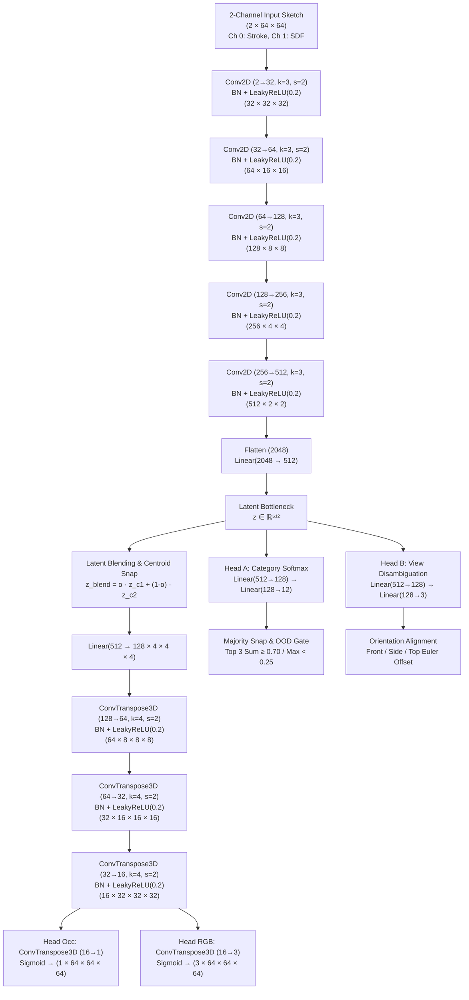

# 2-3DVX: Real-Time Spatial MR Combat & 2D-to-3D Voxel Neural Reconstruction

[](https://unity.com/)
[](https://docs.unity3d.com/Packages/com.unity.ai.inference@2.6)
[](https://www.khronos.org/openxr/)
[](https://pytorch.org/)
[](LICENSE)

An experimental Mixed Reality (MR) tactical sandbox built in **Unity 6**, combining fast-paced physical gesture combat (**Rock-Paper-Scissors hand tracking**) with a novel on-device deep learning engine: **Draw2Voxel**—a zero-token, sub-15ms multi-task neural network that translates rough 2D hand-drawn strokes into fully volumetric, vertex-colored $64 \times 64 \times 64$ 3D voxel items.

---

## 🌟 Flagship Highlight: On-Device 2D-to-3D Voxel Reconstruction

The centerpiece of **2-3DVX** is the **Draw2Voxel** neural reconstruction pipeline. Players sketch loose, imperfect 2D silhouettes in spatial MR space or on screen, and the model inferentially resolves perspective, categorizes the intended asset, and synthesizes solid 3D voxel geometry with baked vertex colors.

```
       [Player 2D Sketch / Hollow Contour]
   (Rough strokes from any angle in spatial MR)
                 │
                 ▼
     ┌───────────────────────┐
     │ 2-Channel Preprocessor│ ──► [1, 2, 64, 64]
     │ (Stroke AABB + 2D SDF)│     (Normalized Strokes + Truncated Distance Field)
     └───────────┬───────────┘
                 │
                 ▼
     ┌───────────────────────┐
     │   2D Conv Encoder     │ ──► Latent z ∈ ℝ⁵¹²
     └───────────┬───────────┘
                 │
       ┌─────────┴─────────────────────────────────┐
       ▼                                           ▼
┌──────────────┐                           ┌──────────────┐
│  Category    │                           │  Perspective │
│  Classifier  │                           │  Disambiguator│
│(11 Cat + OOD)│                           │ (Front/Side/Top)
└──────┬───────┘                           └──────┬───────┘
       │ [Softmax τ ≥ 0.55 / Majority Snap]        │
       │                                           ▼
       ▼                               [Auto-Orientation Alignment]
┌─────────────────────────────┐
│ Ambiguous / Hybrid Blending │ ──► z_blend = α · z_c1 + (1 - α) · z_c2
│ & Centroid Alignment Engine │
└──────────────┬──────────────┘
               │
               ▼
┌─────────────────────────────┐
│ 3D Deconvolutional Decoder  │ ──► Voxel Occupancy [1, 1, 64³] + RGB [1, 3, 64³]
│ (draw2voxel_decoder.onnx)   │
└──────────────┬──────────────┘
               │
               ▼
┌─────────────────────────────┐
│   Burst Voxel Mesher        │ ──► Zero-Texture Vertex-Colored 3D Mesh
│ (Native Quads + Colors32)   │     (Slow 360° PS2 Trophy Showcase)
└─────────────────────────────┘
```

---

## 🧠 Neural Architecture & Pipeline Deep Dive

### 1. High-Level Pipeline Architecture

The **Draw2Voxel** network (`AntiGravityMultiTaskNet`) is a lightweight multi-task neural network designed for **instant, zero-token, on-device execution**. It simultaneously accomplishes three distinct objectives from a 2-channel normalized sketch input:
1. **Volumetric 3D Synthesis:** Reconstructs the 3D geometry and RGB palette into separated occupancy `[1, 1, 64, 64, 64]` and RGB `[1, 3, 64, 64, 64]` tensors.
2. **Category Classification & OOD Filtering:** Identifies which item archetype was drawn across 11 canonical classes plus a dedicated 12th synthetic `OOD_Reject` class, preventing arbitrary scribble artifacts.
3. **Perspective Disambiguation:** Classifies whether the player drew the object from the **Front ($XY$)**, **Side ($ZY$)**, or **Top ($XZ$)** view, enabling Unity to automatically re-orient the spawned 3D mesh to face the player.
4. **Hybrid Latent Blending:** When an ambiguous drawing bridges multiple sub-classes (e.g. Bear vs Bunny or Sword vs Axe), interpolates between canonical class centroids $z_{\text{blend}} = \alpha \cdot z_{C_1} + (1 - \alpha) \cdot z_{C_2}$ and feeds $z_{\text{blend}}$ into a standalone 3D decoder (`draw2voxel_decoder.onnx`).



---

### 2. Layer-by-Layer Breakdown: What Each Layer Does & Why It Was Chosen

| Component | Layer / Operation | Output Dimension | What It Does | Why This Operation Was Chosen |
| :--- | :--- | :--- | :--- | :--- |
| **Input** | 2-Channel Tensor | `[B, 2, 64, 64]` | **Ch 0:** Tight AABB-centered stroke mask ($52\times 52$).<br>**Ch 1:** Truncated Euclidean Distance Field ($0.0$ at strokes, $1.0$ at empty air). | Solves stroke sparsity and receptive field dropouts; continuous distance gradients allow CNN to trace boundaries reliably. |
| **Encoder L1** | `Conv2d(2→32, k=3, s=2, p=1)`<br>`BatchNorm2d` + `LeakyReLU(0.2)` | `[B, 32, 32, 32]` | Halves spatial resolution; extracts low-level edge and distance gradient primitives. | Kernel 3 with stride 2 avoids information loss from max-pooling; LeakyReLU ($\alpha=0.2$) prevents dying neurons on sparse drawings; BatchNorm stabilizes gradients across varying stroke densities. |
| **Encoder L2** | `Conv2d(32→64, k=3, s=2, p=1)`<br>`BatchNorm2d` + `LeakyReLU(0.2)` | `[B, 64, 16, 16]` | Captures stroke curvature, line junctions, and corner intersections. | Doubling channel depth allows learning complementary stroke patterns (straight lines, arcs, corners) without spatial bloat. |
| **Encoder L3** | `Conv2d(64→128, k=3, s=2, p=1)`<br>`BatchNorm2d` + `LeakyReLU(0.2)` | `[B, 128, 8, 8]` | Assembles strokes into item sub-parts (hilt vs blade, robot limbs, duck bill). | At $8 \times 8$, receptive fields span across the entire drawn object, capturing spatial relationships between parts. |
| **Encoder L4** | `Conv2d(128→256, k=3, s=2, p=1)`<br>`BatchNorm2d` + `LeakyReLU(0.2)` | `[B, 256, 4, 4]` | Aggregates global topological proportions and symmetry axes. | Condenses structural geometry into high-level semantics independent of local jitter. |
| **Encoder L5** | `Conv2d(256→512, k=3, s=2, p=1)`<br>`BatchNorm2d` + `LeakyReLU(0.2)` | `[B, 512, 2, 2]` | Final spatial compression before semantic projection. | Generates a compact spatial representation with 512 feature descriptors. |
| **Latent Projection** | `Flatten` + `Linear(2048→512)` | `[B, 512]` | Projects 2D spatial feature map into global latent embedding $z \in \mathbb{R}^{512}$. | Creates a unified view-invariant representation connecting 2D sketches to 3D voxel space; used for class centroid clustering, latent blending, and OOD distance gating. |
| **Head A (Category)** | `Linear(512→128)` + `LeakyReLU`<br>`Linear(128→12)` | `[B, 12]` | Classifies item archetype across 11 canonical classes + 1 dedicated synthetic OOD class. | Provides classification probabilities. Enables majority labeling, hybrid detection, and OOD rejection. |
| **Head B (Perspective)** | `Linear(512→128)` + `LeakyReLU`<br>`Linear(128→3)` | `[B, 3]` | Disambiguates drawing viewpoint (`Front_XY`, `Side_ZY`, `Top_XZ`). | Solves single-view projection ambiguity, allowing Unity to automatically counter-rotate the spawned 3D mesh. |
| **Decoder Seed** | `Linear(512→8192)` + `Reshape` | `[B, 128, 4, 4, 4]` | Unflattens 1D latent vector into initial 3D volumetric seed. | Bridges abstract semantic space back into 3D volumetric coordinates ($4^3$ grid with 128 feature channels). |
| **Decoder L1** | `ConvTranspose3d(128→64, k=4, s=2, p=1)`<br>`BatchNorm3d` + `LeakyReLU(0.2)` | `[B, 64, 8, 8, 8]` | Upsamples volume $2\times$; establishes primary volumetric mass. | 3D transposed convolution with kernel 4 and stride 2 performs smooth volumetric interpolation without checkerboard artifacts. |
| **Decoder L2** | `ConvTranspose3d(64→32, k=4, s=2, p=1)`<br>`BatchNorm3d` + `LeakyReLU(0.2)` | `[B, 32, 16, 16, 16]` | Upsamples volume to $16^3$; outlines macroscopic boundaries. | Adds geometric definition to handles, barrels, shields, and animal appendages. |
| **Decoder L3** | `ConvTranspose3d(32→16, k=4, s=2, p=1)`<br>`BatchNorm3d` + `LeakyReLU(0.2)` | `[B, 16, 32, 32, 32]` | Upsamples volume to $32^3$; refines voxel boundaries and palette transitions. | Segregates surface voxels from interior solid voxels and isolates color regions. |
| **Decoder Head Occ**| `ConvTranspose3d(16→1, k=4, s=2, p=1)`<br>`Sigmoid()` | `[B, 1, 64, 64, 64]` | Synthesizes full $64^3$ binary voxel occupancy probabilities. | Decoupling occupancy from color prediction improves interior solid volume convergence. |
| **Decoder Head RGB**| `ConvTranspose3d(16→3, k=4, s=2, p=1)`<br>`Sigmoid()` | `[B, 3, 64, 64, 64]` | Synthesizes full $64^3$ RGB color channels. | Dedicated head ensures vibrant vertex colors without interfering with occupancy thresholding. |

---

### 3. Multi-Task Loss Formulation

Training a network to simultaneously learn 3D volumetric occupancy, RGB color palettes, object classification, and camera perspective requires a balanced multi-task loss function:

$$\mathcal{L}_{total} = \mathcal{L}_{occ} + 0.5 \cdot \mathcal{L}_{rgb} + 0.3 \cdot \mathcal{L}_{cat} + 0.3 \cdot \mathcal{L}_{view}$$

#### A. Occupancy Loss ($\mathcal{L}_{occ}$): Combined BCE + Soft Dice
In a $64 \times 64 \times 64$ grid (262,144 voxels), solid objects typically occupy less than **5%** of total space, while over **95%** is empty air. A naive Binary Cross-Entropy (BCE) loss suffers from extreme class imbalance, often causing the model to predict empty space everywhere to minimize loss.

To resolve this, we combine BCE with **Soft Dice Loss**, which directly optimizes the volumetric Intersection-over-Union (IoU):

$$\mathcal{L}_{Dice} = 1 - \frac{2 \sum_{i} p_i y_i + \epsilon}{\sum_i p_i + \sum_i y_i + \epsilon}$$

$$\mathcal{L}_{occ} = \mathcal{L}_{BCE}(p_{occ}, y_{occ}) + 2.0 \cdot \mathcal{L}_{Dice}$$

#### B. Masked RGB Color Loss ($\mathcal{L}_{rgb}$)
Color prediction is only meaningful where geometry actually exists. Computing Mean Squared Error (MSE) across empty air forces the network to predict an average muddy gray background color, degrading surface color vibrancy. We compute MSE **strictly masked to ground-truth solid voxels**:

$$\mathcal{L}_{rgb} = \frac{\sum_{i} \left( (c_{pred, i} - c_{gt, i})^2 \cdot \mathbb{I}_{y_{occ, i} = 1} \right)}{\sum_i \mathbb{I}_{y_{occ, i} = 1} + \epsilon}$$

#### C. Semantic Auxiliary Regularization ($\mathcal{L}_{cat}$ and $\mathcal{L}_{view}$)
Category classification and perspective classification use standard Cross-Entropy losses:
- $\mathcal{L}_{cat} = -\log \frac{\exp(s_{y_{cat}})}{\sum_j \exp(s_j)}$ (11 classes)
- $\mathcal{L}_{view} = -\log \frac{\exp(v_{y_{view}})}{\sum_k \exp(v_k)}$ (3 views: $XY, ZY, XZ$)

These classification heads force the latent vector $z \in \mathbb{R}^{512}$ to retain distinct semantic clusters and viewpoint orientation knowledge rather than blurring representations together.

---

### 4. Procedural Dataset Generation & Human Tremor Simulation

To train the model offline without manual 3D modeling or cloud API labeling, the pipeline includes an automated procedural generator (`Tools/DataGen/generate_dataset_triview.py`):

1. **11 Parametric Ground Truth Archetypes:**
   - **Weapons:** Broadsword, Tower Shield, Tactical Blaster / Pistol, Battle Axe.
   - **Toys:** Teddy Bear, Rubber Duck, Toy Robot, Toy Bunny.
   - **Electronics:** Retro Gamepad, CRT Television, Handheld Game Boy.
2. **Constructive Solid Geometry (CSG) with Semantic Palettes:**
   - Assets are procedurally assembled from 3D primitives (boxes, cylinders, spheres) with distinct semantic colors (e.g., Rubber Duck: Yellow body `[0.95, 0.85, 0.10]`, Orange beak `[0.95, 0.40, 0.05]`, Black eyes `[0.1, 0.1, 0.1]`).
3. **Tri-View Orthographic Projections:**
   - Collapses the 3D voxel grid into 3 canonical 2D views:
     - **Front View ($XY$):** $\max_z V(x, y, z)$
     - **Side View ($ZY$):** $\max_x V(x, y, z)$
     - **Top View ($XZ$):** $\max_y V(x, y, z)$
4. **Human Sketch Noise Simulation:**
   - **Canny/Sobel Edge Outlining:** Converts solid silhouettes into pen strokes.
   - **Elastic Deformation:** Simulates hand tremor using low-pass filtered random Gaussian vector fields ($\alpha \in [4.0, 7.5], \sigma \in [2.0, 3.0]$).
   - **Stroke Pressure & Dilation:** Varies line thickness using random morphological dilation/erosion.
   - **Affine Perturbations:** Random rotation ($\pm 10^\circ$) and translation ($\pm 2.5\text{px}$) to simulate off-center sketching.
   - **Stroke Dropout:** Randomly erases small segments to simulate lifting the pen/stylus off the canvas.

---

### 5. Training Results & Metrics

Trained on an NVIDIA RTX 4050 GPU for 18 epochs using AdamW optimizer ($\text{lr} = 1\times 10^{-3}$, cosine annealing):
- **Voxel Occupancy IoU:** **96.60%**
- **Category Classification Accuracy:** **99.7%**
- **Perspective Disambiguation Accuracy:** **100.0%**
- **ONNX Model Size:** **29.17 MB**
- **Inference Latency:** **< 15 ms** on GPU Compute via Unity Sentis / Inference Engine.

---

## ⚠️ Important Notice: Why This Is Not a Final Iteration

> [!WARNING]
> **Research & Prototype Status Notice**
> The current **Draw2Voxel** pipeline is an intermediate technical prototype designed to validate real-time, zero-token on-device 2D-to-3D voxel synthesis in Mixed Reality. It is **not** a final general-purpose production model due to intentional dataset and architectural boundaries outlined below.

### 1. Synthetic-to-Real Domain Gap
- **What is currently used:** The training dataset consists of 3,300 procedurally generated shapes augmented with synthetic elastic deformation and morphological dilation.
- **The limitation:** While elastic noise accurately models physical hand tremor, real human sketchers introduce artistic abstraction, symbolic shorthand (e.g., drawing just an antenna or a star instead of a full television or shield), discontinuous stroke styles, and uneven pen pressure that synthetic filters cannot fully replicate.

### 2. Closed-Set Inductive Bias (11 Archetypes)
- **What is currently used:** The model operates as an inductive prior over **11 specific target classes** (`Sword`, `Shield`, `Blaster`, `Axe`, `TeddyBear`, `RubberDuck`, `ToyRobot`, `ToyBunny`, `Gamepad`, `RetroTV`, `GameBoy`).
- **The limitation:** The network does **not** perform open-vocabulary zero-shot 3D generation. If a player sketches an elephant, a sports car, or a flower, the system will either:
  - Snap the drawing to the closest allowable latent centroid (e.g. mapping an elephant to a Teddy Bear or Bunny), or
  - Reject the drawing as an Out-of-Distribution (OOD) invalid shape when confidence $\tau < 0.60$.
  - It cannot generate arbitrary unseen objects outside its training manifold.

### 3. Tri-View Orthographic vs. Arbitrary Perspective
- **What is currently used:** The network is explicitly trained on three canonical orthographic projections: Front ($XY$), Side ($ZY$), and Top ($XZ$).
- **The limitation:** In spatial Mixed Reality, players often sketch at arbitrary three-quarter ($3/4$) isometric angles, tilted oblique planes, or with perspective foreshortening. The current model forces any input sketch into the closest canonical orthogonal projection.

### 4. Discrete $64^3$ Voxel Grid Quantization
- **What is currently used:** A fixed resolution of $64 \times 64 \times 64$ (262,144 voxels), extracted into surface quads using a multi-threaded Burst mesher.
- **The limitation:** While $64^3$ provides a charming retro/arcade aesthetic and can be meshed in under 5ms, it cannot represent sub-voxel curves, ultra-thin geometric features (e.g., sharp needle tips or weapon engravings), or organic CAD-quality surfaces. Continuous representations (such as Neural Signed Distance Fields, NeRFs, or 3D Gaussian Splatting) will be explored for future non-voxel asset pipelines.

### 5. Palette Averaging vs. Fine Texture Detail
- **What is currently used:** The decoder outputs 3 RGB channels mapped directly to vertex colors.
- **The limitation:** Voxels synthesize macroscopic color blocks (e.g., yellow duck body with an orange beak), but cannot reproduce micro-textures, specular maps, metallic roughness, or intricate surface patterns.

### 🔮 Future Iteration Roadmap
- [ ] **QuickDraw & Real Human Sketch Transfer:** Fine-tuning the encoder on crowd-sourced human sketch datasets (Google QuickDraw, Sketchfab) paired with 3D ShapeNet models.
- [ ] **Continuous Implicit Fields (Local SDFs):** Migrating from discrete $64^3$ grids to coordinate-based implicit decoders for smooth continuous meshes.
- [ ] **Dynamic View Pose Regression:** Replacing 3-class view classification with continuous Euler angle regression $(\theta, \phi, \psi)$ to handle arbitrary sketching angles in 3D space.
- [ ] **Hierarchical Voxel Octrees (SVO):** Scaling resolution to $128^3$ and $256^3$ via sparse octree traversal to preserve fine details without memory blowup.

---

## 🎮 Gameplay Features

### 1. Rock-Paper-Scissors (RPS) Mixed Reality Combat
- **Gesture Recognition:** Driven by `RPSDetector.cs`, tracking finger curl values and hand poses via OpenXR Hand Tracking.
- **Elemental Affinity Triad:**
  - ✊ **Rock / Blunt:** Crushes Blasters, vulnerable to Blade parries.
  - ✋ **Paper / Shield:** Deflects kinetic projectiles, vulnerable to piercing blades.
  - ✌️ **Scissors / Blade:** Pierces Shields, vulnerable to heavy blunt strikes.

### 2. PS2-Style Trophy Showcase
- Completed 3D items spawn onto a floating retro pedestal.
- Powered by `PS2ShowcaseRotator.cs`, the mesh rotates 360° with smooth sinusoidal bobbing and retro UI styling—reminiscent of classic PS2 trophy and weapon preview screens.

### 3. Interactive Desktop Testing Harness (`MousePaintCanvas.cs`)
- In-editor desktop test harness allowing players to draw freehand with mouse or load multi-category presets (**Broadsword**, **Tactical Pistol**, **Sci-Fi Blaster**, **Teddy Bear**, **Rubber Duck**, **Retro TV**, **Game Boy**).
- **Instant Holographic Wireframe Preview:** Upon stroke release, instantly generates a 3D cyan wireframe mesh in $<0.5$ ms using Burst jobs, completely masking neural network latency before seamlessly swapping to the fully textured voxel mesh.
- **2-Channel Distance-Field Preprocessor:** Computes tight AABB scaling and 2-pass Euclidean distance transform directly in C# prior to inference.
- Real-time inference HUD showing classified category, hybrid status badges (`[HYBRID TOYS]`, `[HYBRID WEAPONS]`), detected perspective plane, confidence percentage, voxel count, and inference latency in milliseconds.

---

## 📁 Repository Structure

```
2-3DVX/
├── Assets/
│   ├── ML/
│   │   └── Models/
│   │       ├── draw2voxel_multitask.onnx           # 29 MB multi-task Sentis model (Encoder + Class/View Heads + Decoder)
│   │       ├── draw2voxel_decoder.onnx             # 18.7 MB standalone 3D decoder for latent blending & canonical snapping
│   │       ├── draw2voxel_multitask.pt             # PyTorch model weights checkpoint
│   │       ├── draw2voxel_multitask_centroids.json # Latent centroids for OOD rejection & blending
│   │       ├── draw2voxel_v1.onnx                  # Legacy 32³ prototype model
│   │       └── draw2voxel_v1.pt                    # Legacy 32³ checkpoint
│   ├── Scripts/
│   │   ├── Drawing/
│   │   │   ├── DrawingCanvasProjector.cs           # 3D spatial stroke rasterizer
│   │   │   └── StrokeManager.cs                   # Hand gesture stroke collector
│   │   ├── Inference/
│   │   │   ├── SentisMultiTaskEngine.cs            # Multi-task Sentis engine (Majority labeling, Blending, Hull Prior)
│   │   │   └── SentisVoxelEngine.cs                # Legacy single-task fallback engine
│   │   ├── Interaction/
│   │   │   ├── RPSDetector.cs                      # Mixed reality hand gesture detector
│   │   │   └── VoxelWeaponBehavior.cs              # Weapon stats & collision logic
│   │   ├── Tests/
│   │   │   ├── MousePaintCanvas.cs                 # Desktop paint canvas & demo HUD
│   │   │   └── PS2ShowcaseRotator.cs               # 360° retro trophy rotator
│   │   └── VoxelMesh/
│   │       ├── ColoredVoxelJobs.cs                 # Burst quad extraction job
│   │       ├── ColoredVoxelMesher.cs               # Vertex-colored mesh generator
│   │       └── GreedyVoxelMesher.cs                # Legacy binary mesher
│   └── Scenes/
│       └── SampleScene.unity                       # Main interactive test scene
└── Tools/
    └── DataGen/
        ├── generate_dataset_triview.py             # Procedural tri-view synthetic data generator (11 classes)
        ├── train_multitask_model.py                # Multi-task PyTorch trainer & ONNX exporter
        └── test_inference_pipeline.py              # Automated validation test suite
```

---

## 🚀 Getting Started

### Prerequisites
- **Unity 6 (6000.6.4f1 or later)** with Universal Render Pipeline (URP).
- **Unity Inference Engine / Sentis:** `com.unity.ai.inference` (version 2.6.1 or newer).
- **Python 3.11+** with PyTorch and CUDA support for offline training.

### Running in Unity
1. Clone the repository:
   ```bash
   git clone https://github.com/TheDhiruBhai/2-3DVX.git
   cd 2-3DVX
   ```
2. Open the project in **Unity Hub** using **Unity 6000.6.4f1** (or later).
3. Open `Assets/Scenes/SampleScene.unity`.
4. Hit **Play**:
   - Use the mouse on the left canvas to draw custom strokes, or click any preset (**Sword**, **Pistol**, **Teddy Bear**, **Rubber Duck**, **Retro TV**).
   - Click **Reconstruct 3D** to watch the multi-task model classify the shape, disambiguate perspective, synthesize $64^3$ voxels, and render a colored rotating 3D trophy on the pedestal.

### Training the Multi-Task Model (Optional)
If you wish to retrain the weights or add custom archetypes:

1. Create a Python virtual environment and install dependencies:
   ```bash
   python3 -m venv .venv
   source .venv/bin/activate
   pip install torch torchvision onnx numpy scipy matplotlib tqdm
   ```

2. Generate the synthetic tri-view dataset across all 11 classes:
   ```bash
   python Tools/DataGen/generate_dataset_triview.py --samples 3300 --out Tools/DataGen/dataset_triview_64.npz
   ```

3. Train the multi-task network and export to ONNX:
   ```bash
   python Tools/DataGen/train_multitask_model.py \
       --data Tools/DataGen/dataset_triview_64.npz \
       --epochs 18 \
       --batch-size 32 \
       --out Assets/ML/Models/draw2voxel_multitask.onnx
   ```

4. Run the Python validation test suite:
   ```bash
   python Tools/DataGen/test_inference_pipeline.py
   ```

---

## 🛠️ Technology Stack
- **Game Engine:** Unity 6 (6000.6.4f1 URP)
- **Neural Runtime:** Unity Sentis / Inference Engine 2.6.1
- **Acceleration:** Unity C# Job System, Burst Compiler, GPU Compute
- **XR SDK:** OpenXR, Unity XR Interaction Toolkit
- **ML Training:** PyTorch 2.14, CUDA 13.0, ONNX Opset 14

---

## 📜 License
This project is licensed under the MIT License - see the [LICENSE](LICENSE) file for details.
